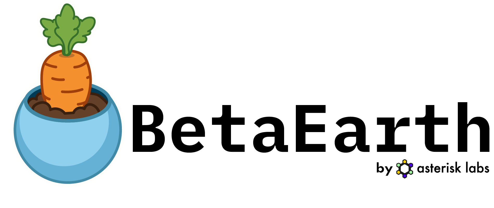

<p class="lead">Open-Source Emulator of AlphaEarth Embedding Product</p>

## What it is

AlphaEarth satellite embedding product is a powerful summary of information derived from several sensors (Sentinel-2, Sentinel-1, Landsat). Yet the model used to generate them is not available for further experimentation or more fine-grained control (for instance to create embeddings that summarise custom temporal range). BetaEarth changes that by training to emulate the embedding product from a single timestamp. The original release supports encoders for Sentinel-2, Sentinel-1, and DEM. While not as performant as the original annual product, BetaEarth can get pretty close in some scenarios. The code is fully open-source so training emulators with different architectures or other modalities is entirely possible.

## Use it

Install from PyPI:

```bash
pip install betaearth
```

Load the default model and embed a scene — any modality can be omitted:

```python
from betaearth import BetaEarth

# Default "curriculum flagship" model (betaearth-segformer-film-robust).
model = BetaEarth.from_pretrained()

embedding = model.predict(
    s2_l2a=s2_l2a,   # (9, H, W) uint16 — bands B02,B03,B04,B08,B05,B06,B07,B11,B12
    s2_l1c=s2_l1c,   # (9, H, W) uint16 — same band order
    s1=s1,           # (2, H, W) float32, linear power — [VV, VH]
    dem=dem,         # (1, H, W) float32, elevation in metres
    doy=182,         # day-of-year of the acquisition (1–366)
)
# embedding: (H, W, 64) float32, L2-normalised per pixel
```

`predict()` tiles internally, so any image size works. Inputs are channel-first; see the repo for exact band order, units, and sources.

## Models

BetaEarth ships **8 variants** trading off quality, size, and which inputs they need. The default, **SegFormer curriculum (flagship)** (`betaearth-segformer-film-robust`), is the only one that stays usable on a single modality (e.g. S1-only or DEM-only). The peak-quality SegFormer+FiLM variants reach the highest fidelity but need all four modalities; **DINOv3 ViT-S/16** (24M params) is the lightweight option; **RGB-only+FiLM** runs from Sentinel-2 RGB alone. Full list and weights on the models page.





